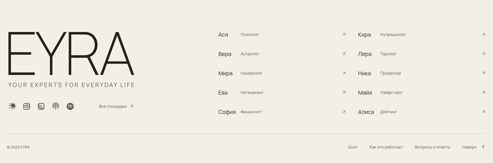
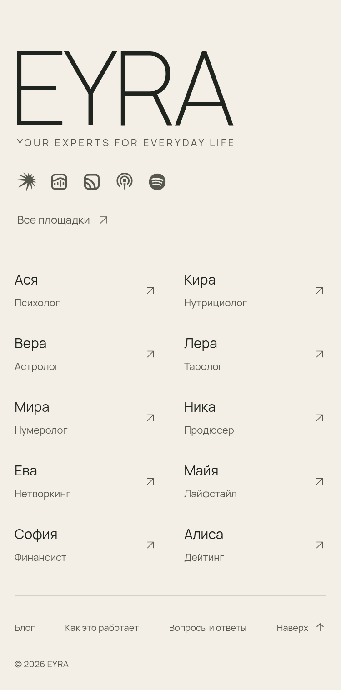
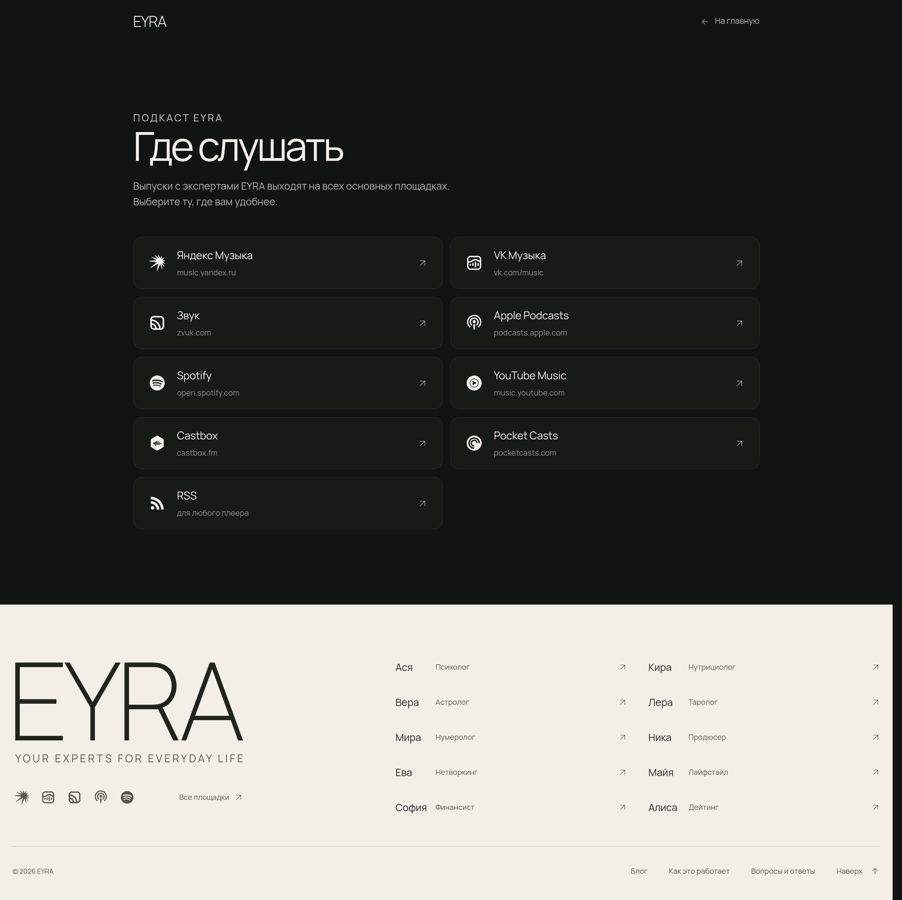
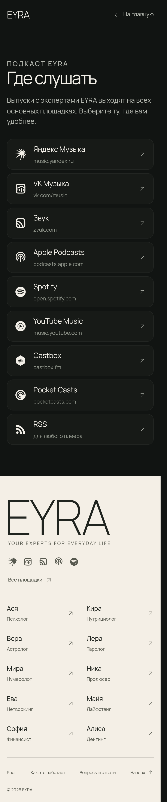

# EYRA · подвал: фон «бумага» + блок площадок + страница /platforms/

Утверждено: 13.11.2026. Подвал — вариант A (строка значков и ссылка «Все площадки ↗»), фон подвала — `#f4efe6`.

## Короткий промпт для Codex (скопировать целиком)

```text
Задача: обнови подвал eyra.ink по утверждённому макету. Нужно сделать три вещи: (1) поменять фон подвала на #f4efe6, (2) добавить под локапом EYRA блок площадок «вариант A», (3) создать страницу /platforms/. Полное ТЗ с готовым кодом лежит в docs/CODEX_FOOTER.md в репо unleaon-hub/eyra-podcasts-concept: https://github.com/unleaon-hub/eyra-podcasts-concept/blob/main/docs/CODEX_FOOTER.md. Скриншоты эталона — в docs/screens/footer/, исходники — в docs/footer-src/. Код вставляй дословно. Всё остальное на сайте не трогай: локап, список экспертов, нижнюю строку, отступы, шрифты и тёмные секции. Плейсхолдеры URL_* замени на реальные ссылки шоу; если ссылки на площадку нет, убери её целиком. В конце пройди чеклист приёмки из раздела 6 и приложи скриншоты подвала на 1440 и 390 и страницы /platforms/.
```

---

## 0. Эталон

| | 1440 | 390 |
|---|---|---|
| Подвал (вариант A, фон #f4efe6) |  |  |
| Страница /platforms/ |  |  |

Рабочие исходники макета (открываются локально рядом с `site.css` и `manrope.woff`):
- `docs/footer-src/footer-A.html` — подвал с блоком A и новым фоном.
- `docs/footer-src/platforms.html` — страница всех площадок.
- `site.css` — копия боевого CSS eyra.ink, в которой изменён только путь к шрифту.

## 1. Цель и главное правило

Сделать три вещи:
1. Сделать фон подвала чище: вместо `#ddd2c0` взять тёплую бумагу `#f4efe6`.
2. Заполнить пустое место под локапом «EYRA + YOUR EXPERTS FOR EVERYDAY LIFE» тихим монохромным блоком площадок.
3. Добавить страницу `/platforms/` со всеми площадками.

**Больше ничего не менять.** Не трогать:
- Знак EYRA, локап и теглайн: размеры, `clamp()`, letter-spacing.
- Колонки экспертов, нижнюю строку `© 2026 EYRA` и её ссылки, отступы подвала.
- Шрифты, цвета текста подвала (`--footer-ink`, `--footer-muted`, `--footer-hover`) и тёмный фон страниц `#111412`.

Единственное изменение существующего правила, кроме фона: `.footer-identity` становится grid-колонкой шириной со знак. Это правило уже есть в CSS ниже.

## 2. Фон подвала

В существующем правиле `.footer` замени `background:var(--paper-deep)` на собственную переменную:

```css
.footer{
  --footer-paper:#f4efe6;            /* было var(--paper-deep) = #ddd2c0 */
  --footer-ink:#20241f;              /* без изменений */
  --footer-muted:#57594f;            /* без изменений */
  --footer-hover:#705032;            /* без изменений */
  background:var(--footer-paper);
  /* остальные свойства .footer не трогать */
}
```

`--paper-deep` в `:root` оставить как есть. Разделитель `.footer-utility` (`#20241f26`) тоже не меняется.

Контраст по WCAG на `#f4efe6`:

| Цвет | Контраст | Норма AA для мелкого текста |
|---|---|---|
| muted `#57594f` | 6.22 : 1 | ≥ 4.5 — проходит |
| ink `#20241f` | 13.8 : 1 | ≥ 4.5 — проходит |
| hover `#705032` | 6.36 : 1 | ≥ 4.5 — проходит |

## 3. Блок площадок в подвале (вариант A)

### 3.1 Значки в спрайт

Добавь эти 5 `<symbol>` внутрь существующего скрытого спрайта, рядом с `#out` и `#arrow` (`<svg aria-hidden="true" style="position:absolute;width:0;height:0;overflow:hidden">`).

Откуда взяты значки:
- Яндекс Музыка, Звук и VK Музыка — официальные знаки (Wikimedia Commons).
- Spotify — Simple Icons.
- Apple Podcasts — знак без плашки, перерисован упрощённо: на 20 px официальная плашка превращается в «i».

Все значки монохромные и красятся через `currentColor`.

```html
<symbol id="pf-yandex" viewBox="0 0 22 22"><g>
    <path d="M21.79,8.39l-.09-.43-3.63-.63,2.11-2.85-.25-.27-3.1,1.49.39-3.95-.32-.18-1.89,3.19L12.91,0h-.37l.5,4.6L7.71.33l-.45.13,4.11,5.16L3.24,2.91l-.37.41,7.26,4.13L.11,8.29l-.11.62,10.41,1.13L1.73,17.22l.37.5,10.33-5.62-2.05,9.9h.63l3.96-9.31,2.41,7.29.43-.33-.99-7.41,3.76,4.27.25-.39-2.88-5.29,4.02,1.49.04-.45-3.6-2.66,3.4-.82Z"/>
  </g></symbol>
<symbol id="pf-vk" viewBox="0 0 24 24"><path d="M14.5 11.3a.9.9 0 0 0-1.8 0v5.5a.9.9 0 1 0 1.8 0v-5.5Zm-4.2.7a.9.9 0 0 1 .9.9v2.2a.9.9 0 0 1-1.8 0v-2.2a.9.9 0 0 1 .9-.9ZM8 13.9a.9.9 0 0 0-1.8 0v.8a.9.9 0 1 0 1.8 0v-.8Zm8.9-1.9a.9.9 0 0 1 .9.9v2.2a.9.9 0 1 1-1.8 0v-2.2a.9.9 0 0 1 .9-.9Z"/><path fill-rule="evenodd" d="M9.462 3c-.948 0-1.714 0-2.334.05-.64.053-1.203.163-1.726.43A4.4 4.4 0 0 0 3.48 5.402c-.267.523-.377 1.087-.43 1.726C3 7.748 3 8.514 3 9.462v5.076c0 .948 0 1.714.05 2.334.053.64.163 1.203.43 1.726a4.4 4.4 0 0 0 1.922 1.922c.523.267 1.087.377 1.726.43.62.05 1.386.05 2.334.05h5.076c.948 0 1.714 0 2.334-.05.64-.053 1.203-.163 1.726-.43a4.4 4.4 0 0 0 1.922-1.922c.267-.523.377-1.087.43-1.726.05-.62.05-1.386.05-2.334V9.462c0-.948 0-1.714-.05-2.334-.053-.64-.163-1.203-.43-1.726a4.4 4.4 0 0 0-1.922-1.922c-.523-.267-1.087-.377-1.726-.43C16.252 3 15.486 3 14.538 3H9.462ZM6.22 5.083c.226-.115.527-.195 1.055-.238C7.813 4.8 8.505 4.8 9.5 4.8h5c.995 0 1.687 0 2.226.045.527.043.828.123 1.054.238a2.6 2.6 0 0 1 1.137 1.137c.115.226.195.527.238 1.055.041.504.045 1.143.045 2.04a22.353 22.353 0 0 0-1.406-.88C16.554 7.729 14.956 7 13.5 7c-1.683 0-2.89.736-3.985 1.403-.152.093-.302.184-.45.272-1.09.644-2.317 1.264-4.265 1.398V9.5c0-.995 0-1.687.045-2.225.043-.528.123-.829.238-1.055A2.6 2.6 0 0 1 6.22 5.083ZM4.8 11.877V14.5c0 .995 0 1.687.045 2.226.043.527.123.828.238 1.054a2.6 2.6 0 0 0 1.137 1.137c.226.115.527.195 1.055.238.538.044 1.23.045 2.225.045h5c.995 0 1.687 0 2.226-.045.527-.043.828-.123 1.054-.238a2.6 2.6 0 0 0 1.137-1.137c.115-.226.195-.527.238-1.055.044-.538.045-1.23.045-2.225v-2.976a22.84 22.84 0 0 0-2.299-1.525C15.698 9.312 14.453 8.8 13.5 8.8c-1.15 0-1.912.46-3.032 1.133l-.488.292c-1.256.743-2.788 1.51-5.18 1.652Z" clip-rule="evenodd"/></symbol>
<symbol id="pf-zvuk" viewBox="-3 -3 127 127"><g transform="translate(0.000000,121.000000) scale(0.100000,-0.100000)"
 stroke="none">
<path d="M174 1180 c-67 -38 -128 -109 -154 -178 -20 -53 -21 -71 -18 -406 l3
-351 28 -50 c40 -72 103 -134 167 -164 l55 -26 360 0 360 0 53 30 c70 38 136
112 162 182 20 54 21 71 18 412 -3 350 -3 357 -26 399 -34 65 -97 128 -155
157 l-51 25 -375 0 -376 0 -51 -30z m796 -120 c22 -11 52 -39 67 -62 l28 -42
3 -337 c3 -325 2 -340 -18 -379 -20 -40 -77 -86 -115 -92 -16 -2 -21 5 -28 37
-29 134 -42 178 -76 250 -112 237 -342 418 -596 470 -44 9 -84 20 -88 24 -5 5
1 27 12 49 20 40 58 73 102 91 13 5 169 10 347 10 305 1 325 0 362 -19z m-743
-295 c217 -51 409 -218 492 -427 34 -88 55 -178 43 -190 -5 -5 -49 -8 -97 -6
l-88 3 -14 58 c-35 156 -193 325 -347 372 l-71 22 -3 78 c-3 79 1 105 15 105
4 0 36 -7 70 -15z m38 -365 c70 -43 147 -157 157 -230 3 -24 1 -25 -67 -28
-85 -3 -133 20 -179 86 -26 37 -31 54 -34 118 -6 103 -3 107 49 89 23 -8 56
-24 74 -35z"/>
</g></symbol>
<symbol id="pf-apple" viewBox="0 0 24 24"><path d="M5.71 17.59A9.4 9.4 0 1 1 18.29 17.59" fill="none" stroke="currentColor" stroke-width="1.9" stroke-linecap="round"/><path d="M8.25 14.76A5.6 5.6 0 1 1 15.75 14.76" fill="none" stroke="currentColor" stroke-width="1.9" stroke-linecap="round"/><circle cx="12" cy="10.2" r="2.35"/><path d="M10.55 13.9h2.9l-.55 7.1a.9.9 0 0 1-1.8 0z"/></symbol>
<symbol id="pf-spotify" viewBox="0 0 24 24"><path d="M12 0C5.4 0 0 5.4 0 12s5.4 12 12 12 12-5.4 12-12S18.66 0 12 0zm5.521 17.34c-.24.359-.66.48-1.021.24-2.82-1.74-6.36-2.101-10.561-1.141-.418.122-.779-.179-.899-.539-.12-.421.18-.78.54-.9 4.56-1.021 8.52-.6 11.64 1.32.42.18.479.659.301 1.02zm1.44-3.3c-.301.42-.841.6-1.262.3-3.239-1.98-8.159-2.58-11.939-1.38-.479.12-1.02-.12-1.14-.6-.12-.48.12-1.021.6-1.141C9.6 9.9 15 10.561 18.72 12.84c.361.181.54.78.241 1.2zm.12-3.36C15.24 8.4 8.82 8.16 5.16 9.301c-.6.179-1.2-.181-1.38-.721-.18-.601.18-1.2.72-1.381 4.26-1.26 11.28-1.02 15.721 1.621.539.3.719 1.02.419 1.56-.299.421-1.02.599-1.559.3z"/></symbol>
```

### 3.2 Разметка

Вставь блок **внутрь `.footer-identity`, сразу после закрывающего `</a>` ссылки `.footer-wordmark`**. Не вкладывай его внутрь ссылки: ссылка внутри ссылки запрещена.

```html
<div class="footer-identity">
  <a aria-label="EYRA — на главную" class="footer-wordmark" href="/">EYRA<span class="footer-lockup"><span class="footer-tagline">Your experts for everyday life</span></span></a>
  <!-- ↓ новый блок -->
<div class="footer-listen fl-a">
  <nav class="fl-icons" aria-label="Слушать подкаст EYRA">
    <a href="URL_YANDEX" aria-label="Яндекс Музыка" title="Яндекс Музыка" target="_blank" rel="noopener"><svg class="pf-g pf-yandex" aria-hidden="true"><use href="#pf-yandex"></use></svg></a>
    <a href="URL_VK" aria-label="VK Музыка" title="VK Музыка" target="_blank" rel="noopener"><svg class="pf-g pf-vk" aria-hidden="true"><use href="#pf-vk"></use></svg></a>
    <a href="URL_ZVUK" aria-label="Звук" title="Звук" target="_blank" rel="noopener"><svg class="pf-g pf-zvuk" aria-hidden="true"><use href="#pf-zvuk"></use></svg></a>
    <a href="URL_APPLE" aria-label="Apple Podcasts" title="Apple Podcasts" target="_blank" rel="noopener"><svg class="pf-g pf-apple" aria-hidden="true"><use href="#pf-apple"></use></svg></a>
    <a href="URL_SPOTIFY" aria-label="Spotify" title="Spotify" target="_blank" rel="noopener"><svg class="pf-g pf-spotify" aria-hidden="true"><use href="#pf-spotify"></use></svg></a>
  </nav>
  <a class="fl-all" href="/platforms/">Все площадки<svg aria-hidden="true"><use href="#out"></use></svg></a>
</div>
</div>
```

**Ссылки.** Вместо `URL_YANDEX`, `URL_VK`, `URL_ZVUK`, `URL_APPLE` и `URL_SPOTIFY` подставь реальные ссылки на шоу EYRA на каждой площадке. Если шоу на какой-то площадке ещё нет, удали этот `<a>` целиком: пустых и `#` ссылок быть не должно.

### 3.3 CSS

Добавь в конец CSS сайта, после правил подвала:

```css
/* ---- EYRA footer · «Слушать» block. Sits under the lockup, exactly as wide as the EYRA ink. ---- */
.footer-identity{display:grid;justify-self:start;align-content:start}
.footer-listen{contain:inline-size;margin-left:1.174%;margin-top:42px;color:var(--footer-muted)}
.footer-listen a{color:var(--footer-muted);transition:color .2s}
.footer-listen a:hover,.footer-listen a:focus-visible{color:var(--footer-ink)}
.footer-listen .pf-g{display:block;width:22px;height:22px;fill:currentColor;stroke:none}
/* optical sizing: tiles read bigger than circles, the star reads smaller */
.footer-listen .pf-apple{transform:scale(1.02)}
.footer-listen .pf-zvuk{transform:scale(.9)}
.footer-listen .pf-vk{transform:scale(1.16)}
.footer-listen .pf-spotify{transform:scale(.92)}
.footer-listen .pf-yandex{transform:scale(1.04)}
.footer-listen svg:not(.pf-g){width:14px;height:14px;transition:transform .25s var(--ease)}
.footer-listen a:hover svg:not(.pf-g){transform:translate(2px,-2px)}
.fl-a{display:flex;align-items:center;justify-content:space-between;gap:16px 20px;flex-wrap:wrap}
.fl-a .fl-icons{display:flex;align-items:center;gap:20px}
.fl-a .fl-icons a{position:relative;display:block}
.fl-a .fl-icons a::before{content:"";position:absolute;inset:-11px}
.fl-a .fl-all{display:flex;align-items:center;gap:8px;font-size:12px;min-height:44px;margin:-11px 0}
@media(max-width:760px){.footer-listen{margin-top:28px}.fl-a .fl-icons{gap:16px}.fl-a .pf-g{width:20px;height:20px}.fl-a .fl-all{min-height:32px;margin:0}}
```

### 3.4 Важно

- **`stroke:none` на значках обязателен.** В `site.css` есть глобальное `svg{fill:none;stroke:currentColor;stroke-width:1.4}`. Без `stroke:none` логотипы получают обводку, становятся толстыми и «плывут».
  - Стрелка `#out` и стрелка Apple Podcasts остаются штриховыми, как задумано.
- **Ширина блока равна ширине знака EYRA** (от ножки E до ножки A) на любом экране, и это работает без JS. Механика:
  - `.footer-identity` сжимается до ширины знака: `display:grid; justify-self:start`.
  - Блок не влияет на ширину колонки, потому что у него `contain:inline-size`.
  - Блок сдвинут на `margin-left:1.174%`. Это оптический отступ ножки E: `.025em / 2.13em` ширины колонки.
  - Если поменяется `font-size` у `.footer-wordmark`, блок подстроится сам.
- **Одинаковый оптический размер значков** (около 20–22 px) держится через `transform:scale()` для каждой площадки. Не убирай эти правила.
- **Hover:** значок и ссылка переходят из `--footer-muted` в `--footer-ink`, стрелка «Все площадки» сдвигается на 2 px вправо и вверх, как у списка экспертов.
- **Зона нажатия:** у каждого значка `::before` с `inset:-11px`, это 44×44 px. Соседние зоны при `gap:20px` не перекрываются.
- **Мобильная версия (≤ 760px) и 1024:** значки остаются в одну строку, «Все площадки ↗» переносится на следующую строку (`flex-wrap`). На мобильном значки 20 px, отступ сверху 28 px. Горизонтального скролла нет.

## 4. Страница /platforms/

Тёмная, в стиле подкаст-страниц и audio.eyra.ink:
- фон `#111412`, текст `#f2efe8`;
- золотой eyebrow `#ccb78f`;
- карточки `#171a17` с волосяной обводкой `#ffffff0d`, при hover — золотая обводка `rgba(204,183,143,.38)`.

Внизу стоит обычный подвал сайта с блоком A.

Структура:
1. Шапка: `EYRA` (ссылка на `/`) и «← На главную».
2. Eyebrow «ПОДКАСТ EYRA», H1 «Где слушать», одна строка подводки.
3. Сетка карточек: 2 колонки на десктопе, 1 на мобильном (≤ 760px). Карточка: значок 26 px, название, домен мелким, стрелка ↗.
4. Порядок карточек: Яндекс Музыка, VK Музыка, Звук, Apple Podcasts, Spotify, YouTube Music, Castbox, Pocket Casts, RSS.
5. Общий подвал сайта.

Файл `/platforms/index.html`: подключи боевой CSS сайта так же, как на главной (`assets/site.<hash>.css` через пайплайн сайта) и общий подвал. Плейсхолдеры `URL_*` замени на реальные ссылки. Для RSS это прямая ссылка на фид.

### 4.1 Дополнительные значки в спрайт (только для этой страницы)

К пяти значкам из 3.1 добавь ещё четыре (все из Simple Icons):

```html
<symbol id="pf-ytmusic" viewBox="0 0 24 24"><path d="M12 0C5.376 0 0 5.376 0 12s5.376 12 12 12 12-5.376 12-12S18.624 0 12 0zm0 19.104c-3.924 0-7.104-3.18-7.104-7.104S8.076 4.896 12 4.896s7.104 3.18 7.104 7.104-3.18 7.104-7.104 7.104zm0-13.332c-3.432 0-6.228 2.796-6.228 6.228S8.568 18.228 12 18.228s6.228-2.796 6.228-6.228S15.432 5.772 12 5.772zM9.684 15.54V8.46L15.816 12l-6.132 3.54z"/></symbol>
<symbol id="pf-castbox" viewBox="0 0 24 24"><path d="M12 0c-.29 0-.58.068-.812.206L2.417 5.392c-.46.272-.804.875-.804 1.408v10.4c0 .533.344 1.135.804 1.407l8.77 5.187c.465.275 1.162.275 1.626 0l8.77-5.187c.46-.272.804-.874.804-1.407V6.8c0-.533-.344-1.136-.804-1.408L12.813.206A1.618 1.618 0 0012 0zm-.85 8.304c.394 0 .714.303.714.676v2.224c0 .207.191.375.427.375s.428-.168.428-.375V9.57c0-.373.32-.675.713-.675.394 0 .712.302.712.675v4.713c0 .374-.318.676-.712.676-.394 0-.713-.302-.713-.676v-1.31c0-.206-.192-.374-.428-.374s-.427.168-.427.374v1.226c0 .374-.32.676-.713.676-.394 0-.713-.302-.713-.676v-1.667c0-.207-.192-.375-.428-.375-.235 0-.427.168-.427.375v3.31c0 .373-.319.676-.712.676-.394 0-.713-.303-.713-.676v-2.427c0-.206-.191-.374-.428-.374-.235 0-.427.168-.427.374v.178a.71.71 0 01-.712.708.71.71 0 01-.713-.708v-2.123a.71.71 0 01.713-.708.71.71 0 01.712.708v.178c0 .206.192.373.427.373.237 0 .428-.167.428-.373v-1.53c0-.374.32-.676.713-.676.393 0 .712.303.712.676v.646c0 .206.192.374.427.374.236 0 .428-.168.428-.374V8.98c0-.373.319-.676.713-.676zm4.562 2.416c.393 0 .713.302.713.676v2.691c0 .374-.32.676-.713.676-.394 0-.712-.303-.712-.676v-2.691c0-.374.319-.676.712-.676zm2.28 1.368c.395 0 .713.303.713.676v.67c0 .374-.318.676-.712.676-.394 0-.713-.302-.713-.675v-.67c0-.374.32-.677.713-.677Z"/></symbol>
<symbol id="pf-pocketcasts" viewBox="0 0 24 24"><path d="M12,0C5.372,0,0,5.372,0,12c0,6.628,5.372,12,12,12c6.628,0,12-5.372,12-12 C24,5.372,18.628,0,12,0z M15.564,12c0-1.968-1.596-3.564-3.564-3.564c-1.968,0-3.564,1.595-3.564,3.564 c0,1.968,1.595,3.564,3.564,3.564V17.6c-3.093,0-5.6-2.507-5.6-5.6c0-3.093,2.507-5.6,5.6-5.6c3.093,0,5.6,2.507,5.6,5.6H15.564z M19,12c0-3.866-3.134-7-7-7c-3.866,0-7,3.134-7,7c0,3.866,3.134,7,7,7v2.333c-5.155,0-9.333-4.179-9.333-9.333 c0-5.155,4.179-9.333,9.333-9.333c5.155,0,9.333,4.179,9.333,9.333H19z"/></symbol>
<symbol id="pf-rss" viewBox="0 0 24 24"><path d="M19.199 24C19.199 13.467 10.533 4.8 0 4.8V0c13.165 0 24 10.835 24 24h-4.801zM3.291 17.415c1.814 0 3.293 1.479 3.293 3.295 0 1.813-1.485 3.29-3.301 3.29C1.47 24 0 22.526 0 20.71s1.475-3.294 3.291-3.295zM15.909 24h-4.665c0-6.169-5.075-11.245-11.244-11.245V8.09c8.727 0 15.909 7.184 15.909 15.91z"/></symbol>
```

### 4.2 Разметка `<body>` страницы

Спрайт подключи, как на главной. После разметки ниже идёт тот же `<footer>`, что на главной, с блоком A.

```html
<div class="pl-wrap">
  <header class="pl-top">
    <a class="pl-brand" href="/">EYRA</a>
    <a class="pl-back" href="/"><svg aria-hidden="true"><use href="#arrow"></use></svg>На главную</a>
  </header>
  <main>
    <section class="pl-head">
      <p class="pl-eyebrow">Подкаст EYRA</p>
      <h1>Где слушать</h1>
      <p>Выпуски с экспертами EYRA выходят на всех основных площадках. Выберите ту, где вам удобнее.</p>
    </section>
    <ul class="pl-list">
      <li><a class="pl-card" href="URL_YANDEX" target="_blank" rel="noopener"><svg class="pf-g pf-yandex" aria-hidden="true"><use href="#pf-yandex"></use></svg><span class="pl-name">Яндекс Музыка<small>music.yandex.ru</small></span><svg class="pl-out" aria-hidden="true"><use href="#out"></use></svg></a></li>
      <li><a class="pl-card" href="URL_VK" target="_blank" rel="noopener"><svg class="pf-g pf-vk" aria-hidden="true"><use href="#pf-vk"></use></svg><span class="pl-name">VK Музыка<small>vk.com/music</small></span><svg class="pl-out" aria-hidden="true"><use href="#out"></use></svg></a></li>
      <li><a class="pl-card" href="URL_ZVUK" target="_blank" rel="noopener"><svg class="pf-g pf-zvuk" aria-hidden="true"><use href="#pf-zvuk"></use></svg><span class="pl-name">Звук<small>zvuk.com</small></span><svg class="pl-out" aria-hidden="true"><use href="#out"></use></svg></a></li>
      <li><a class="pl-card" href="URL_APPLE" target="_blank" rel="noopener"><svg class="pf-g pf-apple" aria-hidden="true"><use href="#pf-apple"></use></svg><span class="pl-name">Apple Podcasts<small>podcasts.apple.com</small></span><svg class="pl-out" aria-hidden="true"><use href="#out"></use></svg></a></li>
      <li><a class="pl-card" href="URL_SPOTIFY" target="_blank" rel="noopener"><svg class="pf-g pf-spotify" aria-hidden="true"><use href="#pf-spotify"></use></svg><span class="pl-name">Spotify<small>open.spotify.com</small></span><svg class="pl-out" aria-hidden="true"><use href="#out"></use></svg></a></li>
      <li><a class="pl-card" href="URL_YTMUSIC" target="_blank" rel="noopener"><svg class="pf-g pf-ytmusic" aria-hidden="true"><use href="#pf-ytmusic"></use></svg><span class="pl-name">YouTube Music<small>music.youtube.com</small></span><svg class="pl-out" aria-hidden="true"><use href="#out"></use></svg></a></li>
      <li><a class="pl-card" href="URL_CASTBOX" target="_blank" rel="noopener"><svg class="pf-g pf-castbox" aria-hidden="true"><use href="#pf-castbox"></use></svg><span class="pl-name">Castbox<small>castbox.fm</small></span><svg class="pl-out" aria-hidden="true"><use href="#out"></use></svg></a></li>
      <li><a class="pl-card" href="URL_POCKETCASTS" target="_blank" rel="noopener"><svg class="pf-g pf-pocketcasts" aria-hidden="true"><use href="#pf-pocketcasts"></use></svg><span class="pl-name">Pocket Casts<small>pocketcasts.com</small></span><svg class="pl-out" aria-hidden="true"><use href="#out"></use></svg></a></li>
      <li><a class="pl-card" href="URL_RSS" target="_blank" rel="noopener"><svg class="pf-g pf-rss" aria-hidden="true"><use href="#pf-rss"></use></svg><span class="pl-name">RSS<small>для любого плеера</small></span><svg class="pl-out" aria-hidden="true"><use href="#out"></use></svg></a></li>
    </ul>
  </main>
</div>
```

`<title>`: «Где слушать подкаст EYRA». `<meta name="description">`: «Подкаст EYRA с экспертами на Яндекс Музыке, VK Музыке, в Звуке, Apple Podcasts, Spotify и других площадках.» Канонический URL: `https://eyra.ink/platforms/`.

### 4.3 CSS страницы

```css
body{margin:0;background:#111412;color:#f2efe8;font-family:Manrope,system-ui,sans-serif}
.pl-wrap{max-width:1040px;margin:0 auto;padding:0 var(--page-inset,20px)}
.pl-top{display:flex;justify-content:space-between;align-items:center;height:68px}
.pl-brand{font-size:24px;font-weight:300;letter-spacing:-.035em;color:#f2efe8}
.pl-back{display:flex;align-items:center;gap:8px;font-size:13px;color:#b4b7af}
.pl-back svg{width:15px;height:15px;transform:rotate(180deg)}
.pl-back:hover{color:#f2efe8}
.pl-head{padding:88px 0 44px;max-width:640px}
.pl-eyebrow{margin:0 0 18px;font-size:11px;font-weight:500;letter-spacing:.14em;text-transform:uppercase;color:#ccb78f}
.pl-head h1{margin:0;font-size:clamp(40px,6vw,64px);font-weight:400;letter-spacing:-.055em;line-height:1}
.pl-head p{margin:20px 0 0;font-size:16px;line-height:1.55;color:#b4b7af;max-width:520px}
.pl-list{list-style:none;margin:0;padding:0 0 120px;display:grid;grid-template-columns:repeat(2,minmax(0,1fr));gap:12px}
.pl-card{display:grid;grid-template-columns:28px 1fr 16px;align-items:center;gap:18px;min-height:84px;padding:0 24px;border-radius:14px;
  background:#171a17;box-shadow:inset 0 0 0 1px #ffffff0d;color:#f2efe8;transition:background .25s,box-shadow .25s}
.pl-card:hover{background:#1c201c;box-shadow:inset 0 0 0 1px rgba(204,183,143,.38)}
.pl-card .pf-g{width:26px;height:26px;fill:currentColor;stroke:none;justify-self:center} /* site.css strokes every svg */
.pl-card .pf-apple{transform:scale(1.02)} .pl-card .pf-zvuk{transform:scale(.9)} .pl-card .pf-vk{transform:scale(1.16)} .pl-card .pf-spotify{transform:scale(.92)}
.pl-card .pf-castbox,.pl-card .pf-pocketcasts,.pl-card .pf-ytmusic{transform:scale(.92)} .pl-card .pf-rss{transform:scale(.8)}
.pl-name{display:flex;flex-direction:column;gap:4px;font-size:17px;letter-spacing:-.01em}
.pl-name small{font-size:12.5px;color:#8f948a;letter-spacing:0}
.pl-out{width:15px;height:15px;color:#b4b7af;transition:transform .25s var(--ease),color .2s}
.pl-card:hover .pl-out{color:#ccb78f;transform:translate(2px,-2px)}
@media(max-width:760px){.pl-head{padding:48px 0 28px}.pl-list{grid-template-columns:1fr;gap:8px;padding-bottom:72px}.pl-card{min-height:72px;padding:0 18px;gap:16px}}
```

Если `--page-inset` на сайте уже определён, он подхватится. Иначе боковой отступ будет 20 px.

## 5. Что не делать

- Не менять цвета значков на брендовые и не делать их цветными: только монохром `--footer-muted`, а при hover `--footer-ink`.
- Не добавлять подпись вроде «Слушайте EYRA» над значками, не увеличивать значки и не ставить их в плашки или кружки.
- Не менять ширину блока: он не должен быть шире знака EYRA.
- Не трогать список экспертов, нижнюю строку и тёмные секции страницы.

## 6. Чеклист приёмки

- [ ] Фон подвала `rgb(244, 239, 230)` (`#f4efe6`). Остальные цвета подвала прежние.
- [ ] Левый край блока совпадает с ножкой E, правый — с правой ножкой A (допуск ±1 px) на ширине:
  - [ ] 1440 — ориентир: 24.3 → 388.1 px;
  - [ ] 1024 — ориентир: 23.1 → 281.7 px;
  - [ ] 390 — ориентир: 18.8 → 256.9 px.
- [ ] Нет горизонтального скролла: `document.documentElement.scrollWidth <= clientWidth` на 1440, 1024, 390 и 360, на главной и на `/platforms/`.
- [ ] Значки визуально одного размера (около 20–22 px), монохромные, без обводки: проверено, что `stroke:none` работает.
- [ ] Зона нажатия каждого значка 44×44 px, зоны соседей не перекрываются.
- [ ] Hover: значок и «Все площадки» темнеют до `--footer-ink`, стрелка сдвигается на 2 px. Видимый `:focus-visible` есть.
- [ ] У каждого значка есть `aria-label` и `title` с названием площадки, у SVG — `aria-hidden="true"`.
- [ ] На десктопе 1440 высота подвала не изменилась: 472 px, как до правки.
- [ ] На 390 значки в одну строку, «Все площадки ↗» строкой ниже, ничего не обрезано.
- [ ] Нет ссылок `#` и `URL_*`: у всех площадок реальные адреса, площадки без адреса удалены.
- [ ] `/platforms/`: 2 колонки на 1440, 1 колонка на 390, hover с золотой обводкой, подвал внизу с блоком A и фоном `#f4efe6`.
- [ ] Скриншоты подвала на 1440 и 390 и страницы `/platforms/` на 1440 и 390 приложены и совпадают с `docs/screens/footer/`.
