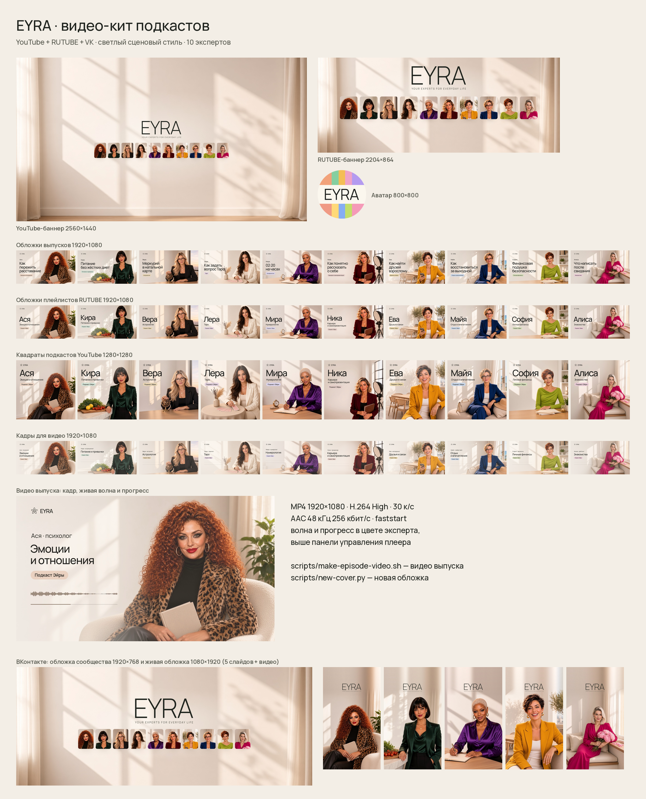

# EYRA · видео-кит подкастов для YouTube, RUTUBE и ВКонтакте

Утверждено 17.11.2026 (аватар обновлён: бейдж с полосами; добавлен раздел ВКонтакте). Светлый сценовый стиль: 10 экспертов, у каждой своя светлая сцена и свой предмет. Все файлы лежат в [`docs/video-kit/`](video-kit/).

## Короткий промпт для Codex (скопировать целиком)

```text
Задача: оформи каналы подкастов EYRA на YouTube и RUTUBE и сообщество EYRA во ВКонтакте, подготовь видео выпусков по утверждённому видео-киту. Полное ТЗ: docs/CODEX_VIDEO_KIT.md в репо unleaon-hub/eyra-podcasts-concept (https://github.com/unleaon-hub/eyra-podcasts-concept/blob/main/docs/CODEX_VIDEO_KIT.md), все файлы — в docs/video-kit/. Готовые картинки ничем не меняй: не пересжимай, не кадрируй, не перерисовывай. Загружай их по таблицам: раздел 2 — YouTube и RUTUBE, раздел 2.1 — ВКонтакте (основная обложка, живая обложка, аватар, превью VK Видео). Где что лежит — в шпаргалке сразу под промптом. Новые обложки делай только через scripts/new-cover.py, видео выпусков — только через scripts/make-episode-video.sh. Id эксперта бери из раздела 4. Если new-cover.py выдал предупреждение «⚠», сократи название и перезапусти; с предупреждением файл не публикуй. Логотип пиши латиницей «EYRA», в русском тексте — «Эйра». Текст никогда не ставь на лицо. В конце пройди чеклист из раздела 7.
```

### Где что брать (шпаргалка)

| Площадка | Что | Файл в `docs/video-kit/` |
|---|---|---|
| YouTube | баннер канала | `youtube/youtube-banner-2560x1440.jpg` |
| YouTube | квадрат подкаста или плейлиста | `playlist-covers/youtube-square/<id>-square-1280x1280.jpg` |
| RUTUBE | обложка канала | `rutube/rutube-banner-2204x864.jpg` |
| RUTUBE | обложка плейлиста | `playlist-covers/rutube-16x9/<id>-rutube-playlist-1920x1080.jpg` |
| VK | основная обложка сообщества | `vk/cover/vk-cover-1920x768.jpg` |
| VK | живая обложка (только приложение) | `vk/live-cover/live-1…5-*-1080x1920.jpg` или `vk/live-cover/live-cover-1080x1920.mp4` |
| VK | превью видео в VK Видео | `episode-covers/<id>-episode-1920x1080.jpg` или результат `new-cover.py` |
| VK | обложка подкаста, картинка к посту | `playlist-covers/youtube-square/<id>-square-1280x1280.jpg` |
| везде | аватар | `avatar/avatar-800.png` |
| YouTube, RUTUBE, VK Видео | превью выпуска | `episode-covers/…` или `scripts/new-cover.py` |
| YouTube, RUTUBE, VK Видео | видео аудио-выпуска | `scripts/make-episode-video.sh` |

---

## 0. Обзор



## 1. Структура

```
docs/video-kit/
├─ youtube/          баннер канала YouTube и превью обрезки
├─ rutube/           обложка канала RUTUBE и превью
├─ avatar/           аватар канала (общий для YouTube, RUTUBE и VK)
├─ vk/
│  ├─ cover/         основная обложка сообщества VK 1920×768 и превью
│  └─ live-cover/    живая обложка VK: 5 слайдов, видео, all-10/, лист проверки
├─ episode-covers/   обложки (превью) выпусков, по одной на эксперта
├─ playlist-covers/
│  ├─ youtube-square/   квадраты подкастов/плейлистов YouTube
│  └─ rutube-16x9/      обложки плейлистов RUTUBE
├─ video-frame/
│  ├─ frames/        кадры для видео аудио-выпуска
│  ├─ layout.tsv     где рисовать волну и прогресс у каждого эксперта
│  └─ sample-asya-10s.mp4   пример готового видео
├─ scripts/
│  ├─ make-episode-video.sh  видео выпуска из аудио
│  ├─ new-cover.py           новая обложка или кадр с названием
│  ├─ template/              HTML-шаблон, данные экспертов, фоны и маски
│  ├─ banner/                исходник баннеров (ch4.html, lock.js, tiles.py)
│  ├─ avatar/                исходник аватара (badge.html, render.py)
│  └─ vk/                    исходник живой обложки VK (live.py, kb.py, lock.py)
├─ README.md  CHANGELOG.md  overview-kit.png
```

Структуру не меняй: `make-episode-video.sh` ищет кадры в `../video-frame/` относительно себя, `new-cover.py` ищет шаблон в `./template/`.

## 2. Что куда загружать

| Файл | Размер и вес | Куда |
|---|---|---|
| `youtube/youtube-banner-2560x1440.jpg` | 2560×1440, ~0,3 МБ (лимит YouTube 6 МБ) | YouTube Studio → Настройка канала → Брендинг → Баннер. Логотип и ряд экспертов стоят в безопасной зоне 1235×338, поэтому видны на ТВ, компьютере и телефоне |
| `youtube/preview-youtube-banner.png` | — | Только для проверки: как баннер обрежется на ТВ, компьютере и телефоне. Не загружать |
| `rutube/rutube-banner-2204x864.jpg` | 2204×864, ~0,3 МБ (лимит 10 МБ) | RUTUBE Студия → Настройки канала → Обложка. Нижние ~25% закрывают аватар и «Подписаться», поэтому там пусто |
| `rutube/preview-rutube-banner.png` | — | Проверка обрезки и наложений. Не загружать |
| `avatar/avatar-800.png` | 800×800 PNG | **Основной аватар** для YouTube и RUTUBE: бейдж EYRA. Сверху и снизу по 5 полос в цветах экспертов, посередине кремовая полоса со словом «EYRA». Площадки сами обрежут его в круг. Ширины колонок подобраны так, что в круге у каждого цвета одинаковая площадь, а слово стоит в 100 px от края |
| `avatar/avatar-alt-ring-800.png` | 800×800 | Запасной аватар: цветок в кольце из 10 акцентов. Не загружать без решения |
| `avatar/avatar-alt-gold-ring-800.png` | 800×800 | Ещё один запасной, с золотым кольцом. Не загружать без решения |
| `avatar/preview-avatar.png` | — | Как основной и запасной аватары выглядят в 800/98/48/32/24 px на тёмном и светлом фоне и в шапках YouTube и RUTUBE. Не загружать |
| `avatar/avatar-ring-options.png`, `avatar-sizes-dark-light.png` | — | Справочные листы: все варианты кольца и как аватар читается в мелких размерах. Не загружать |
| `episode-covers/<id>-episode-1920x1080.jpg` | 1920×1080, до 0,5 МБ (лимит 2 МБ) | Превью выпуска на YouTube (Видео → Значок) и RUTUBE (Обложка видео). Это образцы с первыми темами; для новых выпусков делай обложку через `new-cover.py` |
| `playlist-covers/youtube-square/<id>-square-1280x1280.jpg` | 1280×1280 | YouTube: квадратная обложка подкаста или плейлиста эксперта (Контент → Подкасты/Плейлисты → Изменить → Обложка) |
| `playlist-covers/rutube-16x9/<id>-rutube-playlist-1920x1080.jpg` | 1920×1080 | RUTUBE: обложка плейлиста или серии. Квадрата на RUTUBE нет, поэтому на обложке только имя и рубрика, без названия выпуска |
| `video-frame/frames/<id>.png` | 1920×1080 PNG | Фон видео для аудио-выпуска: спокойная версия обложки, слева место под волну и прогресс. Отдельно не загружается, его берёт `make-episode-video.sh` |
| `video-frame/sample-asya-10s.mp4` | 1920×1080, 10 с, ~2,8 МБ | Пример готового видео (звук синтетический). Не загружать |

## 2.1. ВКонтакте

Все файлы для VK лежат в `vk/`. Готовые файлы из других папок тоже подходят для VK, см. таблицу.

| Файл | Размер | Куда в VK |
|---|---|---|
| `vk/cover/vk-cover-1920x768.jpg` (или `.png`) | 1920×768, JPG 0,2 МБ / PNG 0,8 МБ (лимит 10 МБ) | Сообщество → **Управление → Обложка** (в некоторых версиях: Управление → Настройки → Обложка сообщества) → Загрузить. Это основная обложка, видна на компьютере и в приложении |
| `vk/cover/preview-vk-cover.png` | — | Проверка: безопасные зоны и макеты компьютера и телефона. Не загружать |
| `vk/live-cover/live-1-asya-1080x1920.jpg` … `live-5-alisa-1080x1920.jpg` | 1080×1920, 0,3–0,4 МБ | **Управление → Обложка → Живая обложка → Загрузить** (настраивается с телефона или с компьютера): до 5 слайдов по порядку 1–5. Живая обложка видна только в мобильном приложении |
| `vk/live-cover/live-cover-1080x1920.mp4` | 1080×1920, H.264 High + AAC (тишина), 30 к/с, 23,6 с, 10,5 МБ (лимит 30 с и 20 МБ) | Туда же, в живую обложку, **вместо слайдов** или одним из 5 элементов. В ролике все 10 сцен с медленным зумом; конец плавно переходит в начало, поэтому повтор идёт без скачка |
| `vk/live-cover/all-10/<id>-1080x1920.jpg` | 1080×1920 | Слайды всех 10 экспертов: любой можно поставить вместо слайда из набора 1–5 |
| `vk/live-cover/preview-vk-live-cover.png` | — | Лист проверки: 5 слайдов с зонами, макет приложения, кадры видео, остальные сцены. Не загружать |
| `avatar/avatar-800.png` | 800×800 (VK просит не меньше 400×400) | На странице сообщества: **фото → Обновить фотографию**, миниатюру выбрать кругом по центру. Слово «EYRA» целиком внутри круга |
| `episode-covers/<id>-episode-1920x1080.jpg` и обложки из `new-cover.py` | 1920×1080 (VK Видео просит 1280×720 и больше, 16:9) | **VK Видео → видео → Редактировать → Обложка → Загрузить свою**. Правый нижний угол свободен от текста: там VK ставит длительность |
| `playlist-covers/youtube-square/<id>-square-1280x1280.jpg` | 1280×1280 | Обложка подкаста в VK (в настройках подкаста), картинка к посту или обложка плейлиста VK Видео. VK просит квадрат от 510×510 |

**Безопасные зоны**
- **Основная обложка 1920×768.** На телефоне края обрезаются; справка VK советует держать важное в 10–15% от краёв, это 192–288 px по бокам. Логотип и ряд экспертов стоят в x 402–1518 и y 202–530, то есть внутри центра 1196×400, видимого на телефоне. Поля по бокам 21%. Нижний левый угол свободен под аватар: на компьютере примерно x 0–330, на телефоне x 362–640, по высоте y ≥ 600.
- **Живая обложка 1080×1920.** Верх 0–280 px занят статус-баром и кнопками «назад»/«меню», низ 1520–1920 px — названием сообщества и кнопками «Подписаться» и «Написать». Там только фон: стена сверху, низ кадра снизу. Логотип стоит на y 300–475, лица — примерно на y 560–1120. Рекламных надписей нет.

**Пересборка** (обычно не нужна): основная обложка — `docs/video-kit/scripts/banner/ch4.html?m=vk` в Chromium, окно 1920×768. Слайды живой обложки: `cd docs/video-kit/scripts/vk && python3 lock.py 120 && python3 live.py` → `slide-<id>.png`, видео: `python3 kb.py` → `live-cover.mp4` (нужны Pillow, numpy, Playwright с Chromium и ffmpeg; около 2 минут).

## 3. Скрипты

### 3.1. Зависимости

| Скрипт | Что нужно |
|---|---|
| `make-episode-video.sh` | bash, `ffmpeg` и `ffprobe` версии 5+ (`brew install ffmpeg` или `apt install ffmpeg`), `awk` |
| `new-cover.py` | Python 3.9+, `pip install playwright pillow`, потом `playwright install chromium` (или установленный Google Chrome) |
| `banner/tiles.py` (только при пересборке баннеров) | Python 3, `pillow` |

### 3.2. Видео выпуска: `make-episode-video.sh`

```bash
cd docs/video-kit/scripts
chmod +x make-episode-video.sh            # один раз
./make-episode-video.sh ~/audio/ep12.wav asya ep12-asya.mp4
```

- Аргументы: `<аудио> <id эксперта> [выход.mp4]`. Аудио — любой формат, который читает ffmpeg (wav, mp3, m4a, flac). Если выход не указан, файл будет `<аудио>-<id>.mp4`.
- Что делает: берёт кадр эксперта и рисует поверх живую волну по звуку и тонкую линию прогресса в цвете акцента эксперта. Координаты берутся из `video-frame/layout.tsv`. Волна стоит в левой колонке, выше панели управления плеера.
- На выходе: MP4 1920×1080, H.264 High 4.1, yuv420p, 30 к/с, AAC 48 кГц стерео 256 кбит/с, `+faststart`. Файл подходит и для YouTube, и для RUTUBE.
- Скорость: примерно 3× реального времени, час аудио кодируется около 20 минут.
- Переменные окружения:
  - `PRESET=fast` — быстрее (по умолчанию `medium`);
  - `CRF=18` — качественнее (по умолчанию `20`);
  - `FRAME=/путь/кадр.png` — свой кадр, например с названием выпуска из `new-cover.py --kind frame`.

### 3.3. Новая обложка или кадр: `new-cover.py`

```bash
cd docs/video-kit/scripts
python3 new-cover.py vera "Луна в Раке: что важно знать"            # обложка 1920×1080 JPG
python3 new-cover.py kira "Сахар и усталость" --kind frame           # кадр для видео с названием (PNG)
python3 new-cover.py vera "Луна в Раке" --out ~/covers/ep14.jpg      # свой путь
FRAME=kira-sahar-i-ustalost-frame-1920x1080.png ./make-episode-video.sh ep13.wav kira
```

- Название — 2–3 строки, лучше до ~32 знаков. Предлоги и короткие слова шаблон сам привязывает неразрывным пробелом.
- Скрипт сам проверяет, что текст не заходит на эксперта и помещается в колонку. При успехе пишет `✓ проверка пройдена`. При проблеме пишет `⚠ …`: тогда сократи название или подбери короче слова и перезапусти.
- Размер заголовка одинаковый у всех экспертов (80 px на 1920×1080). Шаблон его не уменьшает, чтобы обложки в ленте выглядели одинаково.

### 3.4. Пересборка баннеров и аватара (обычно не нужна)

`scripts/banner/ch4.html` — исходник баннеров: логотип EYRA сверху по центру, под ним один ряд из 10 экспертов. `lock.js` — логотип как в подвале сайта. `tiles.py` — плитки экспертов из фонов в `template/work/` по лицам из `faces.json`. Открывается в Chromium с флагом `--allow-file-access-from-files`. Готовые JPG уже лежат в `youtube/` и `rutube/`; без новой задачи баннеры не пересобирай.

Аватар: `scripts/avatar/badge.html` — бейдж с 10 полосами (палитра из старого бейджа EYRA). Сборка: `cd docs/video-kit/scripts/avatar && python3 render.py` → `avatar-800.png` (нужны `playwright` и Chromium, как для `new-cover.py`). Параметры в URL: `band` — высота кремовой полосы (0.388), `ww` — ширина слова (0.703), `wt` — насыщенность (380), `eq=0` — равные колонки вместо равной площади в круге.

## 4. Эксперты (id)

| id | Имя | Роль | Шоу | Акцент |
|---|---|---|---|---|
| `asya` | Ася | психолог | Эмоции и отношения | `#ddb79c` |
| `kira` | Кира | нутрициолог | Питание и привычки | `#b9cebb` |
| `vera` | Вера | астролог | Астрология | `#d8b988` |
| `lera` | Лера | таролог | Таро | `#d4b8c9` |
| `mira` | Мира | нумеролог | Нумерология | `#c7b9df` |
| `nika` | Ника | продюсер | Карьера и самопрезентация | `#d4afa3` |
| `eva` | Ева | нетворкинг | Друзья и связи | `#d8ba78` |
| `maya` | Майя | лайфстайл | Отдых и впечатления | `#a8bdd9` |
| `sofia` | София | финансы | Личные финансы | `#b9c58e` |
| `alisa` | Алиса | дейтинг | Знакомства | `#d8a9ba` |

Данные лежат в `scripts/template/sdata.js`. Там же ширина колонки заголовка (`tw`) и для кадра (`fw`) у каждого эксперта.

## 5. Правила

- Логотип латиницей «EYRA», в русском тексте — «Эйра».
- Текст никогда не ставим на лицо.
- Нижние углы превью на RUTUBE не заняты: там значок 12+ и длительность.
- Цвета, свет и сцены не меняем: их утвердили.
- Старые тёмные баннеры A/B и вариант B светлого баннера не утверждены и в кит не входят.

## 6. Ограничения и оговорки

- **Сцены сгенерированы.** Все 20 фонов (16:9 и 1:1) сделаны генерацией по портретам с сайта, а не сняты фотографом. Сходство проверено, но не идеальное: у Миры черты чуть мягче, чем на портрете, у Киры каре немного короче.
- **Новые сцены скриптом не сделать.** `new-cover.py` меняет только текст. Новый эксперт или новая сцена — отдельная задача дизайна: фон, маска и запись в `sdata.js`.
- **Узкие колонки.** У Миры колонка заголовка 360 px, у Веры и Аси около 450–470 px, поэтому длинные слова в одну строку могут не влезть (например, «Зеркальные» у Миры). Скрипт предупредит.
- **Проверка обрезки — по опубликованным правилам площадок.** Безопасная зона YouTube 1235×338 и низ обложки RUTUBE, закрытый аватаром, проверены на превью, а не на живом канале. После загрузки посмотри канал на телефоне и компьютере.
- **Звук в примере синтетический.** `sample-asya-10s.mp4` показывает только картинку, волну и прогресс.
- **Скорость кодирования.** Час аудио — около 20 минут на `medium`. Для черновиков используй `PRESET=fast`.
- **Аватар в мелких размерах.** От 48 px «EYRA» на аватаре читается. На 32 и 24 px (комментарии, подписки) слово превращается в серую черту, канал узнаётся по полосам. Палитра полос ярче приглушённых акцентов обложек: это цвета старого бейджа EYRA, так задумано.
- **VK: интерфейс меняется.** Пути в настройках и безопасные зоны VK взяты из справки VK и свежих гайдов (ноябрь 2026); на живом сообществе их не проверяли. После загрузки посмотри сообщество на телефоне (iOS и Android) и на компьютере.
- **VK: слайды живой обложки собраны из квадратных сцен.** Кадр увеличен в 1,2 раза, верх продолжен мягкой стеной. На телефоне это выглядит чисто, но вблизи слайды чуть мягче обложек 16:9. Строка под «EYRA» на слайдах мелкая (16 px), это скорее фактура, чем текст для чтения.
- **VK: видео живой обложки без звука.** Дорожка AAC есть, но в ней тишина: так требует формат, а VK всё равно проигрывает живую обложку без звука.
- **Шрифт.** Manrope лежит в `scripts/template/manrope.woff` и `scripts/banner/manrope.woff`; ставить его в систему не нужно.

## 7. Чеклист приёмки

- [ ] Баннер YouTube загружен, логотип и все 10 лиц видны на телефоне, компьютере и ТВ-превью в Studio.
- [ ] Обложка RUTUBE загружена, аватар и кнопка не закрывают лица и логотип.
- [ ] Аватар `avatar-800.png` (бейдж с полосами) стоит на обоих каналах. Слово «EYRA» целиком внутри круга, все 10 цветов видны.
- [ ] У каждого эксперта на YouTube есть квадрат подкаста или плейлиста, на RUTUBE — обложка плейлиста 16:9.
- [ ] Каждая новая обложка собрана через `new-cover.py` с `✓ проверка пройдена`.
- [ ] Видео выпуска собрано через `make-episode-video.sh`, волна и прогресс выше панели плеера, звук синхронный.
- [ ] VK: основная обложка загружена. На телефоне логотип и все 10 лиц видны, аватар их не закрывает.
- [ ] VK: живая обложка — 5 слайдов по порядку 1–5 или видео; в приложении верхние кнопки и нижние «Подписаться»/«Написать» не закрывают лица и логотип.
- [ ] VK: аватар в круге, слово «EYRA» целиком; превью видео в VK Видео — из `episode-covers/` или `new-cover.py`.
- [ ] Приложены скриншоты всех каналов и сообщества (компьютер и телефон) и одной страницы выпуска.
