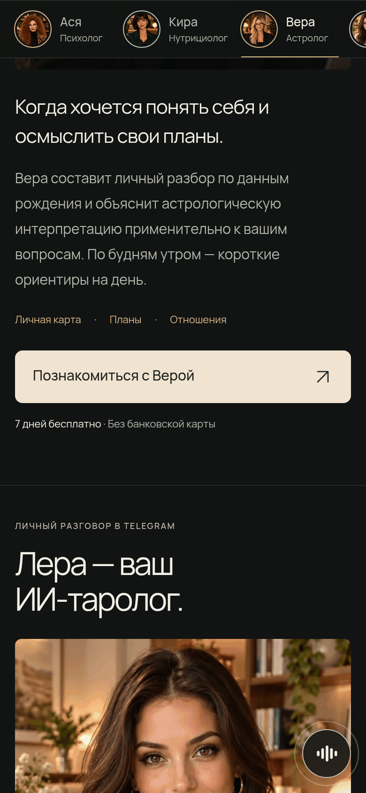
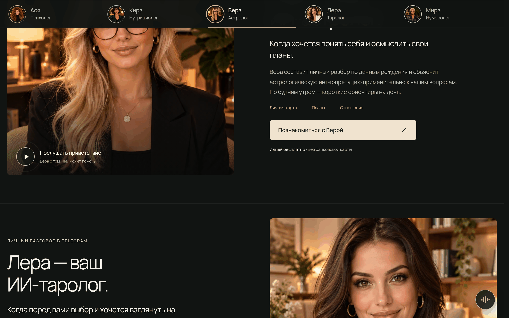
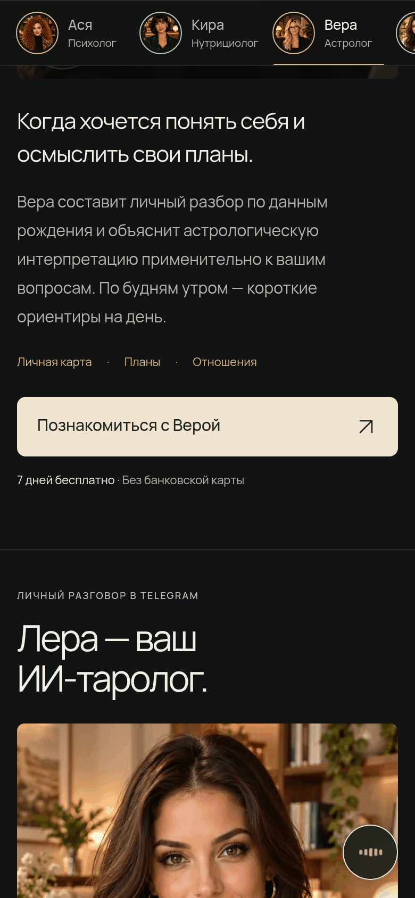
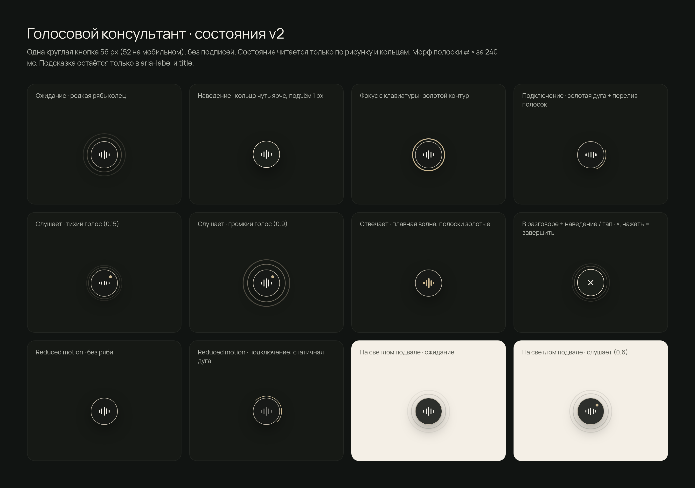
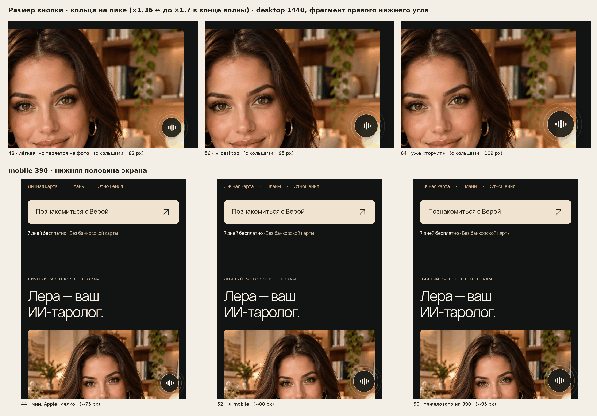
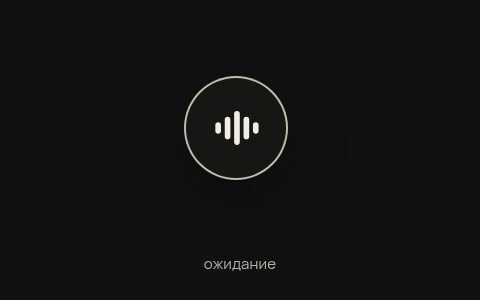

# EYRA · кнопка голосового консультанта (орб v2)

Утверждено: 13.11.2026. Одна круглая кнопка справа внизу, без подписей: 56 px на десктопе, 52 px на мобильном. Состояние разговора видно только по рисунку внутри (полоски ⇄ ×) и по кольцам.

## Короткий промпт для Codex (скопировать целиком)

```text
Задача: добавь на eyra.ink кнопку голосового консультанта по утверждённому макету «орб v2». Полное ТЗ с готовым кодом лежит в docs/CODEX_VOICE.md в репо unleaon-hub/eyra-podcasts-concept: https://github.com/unleaon-hub/eyra-podcasts-concept/blob/main/docs/CODEX_VOICE.md. Скриншоты эталона — в docs/screens/voice/, исходники и кликабельный прототип — в docs/voice-src/. HTML, CSS и JS из разделов 3–5 вставляй дословно, без подписей, пилюль и лишних кнопок. Подключи кнопку к нашему голосовому движку через window.eyraVoice и события eyra-voice-start / eyra-voice-end / eyra-voice-error (раздел 7) и отправь события воронки из раздела 11. Всё остальное на сайте не трогай: вёрстку, подвал, мини-плеер, диалоги, шрифты, цвета. В конце пройди чеклист приёмки из раздела 12 и приложи скриншоты на 1440 и 390 и короткую запись разговора.
```

---

## 0. Эталон

| | 1440 | 390 |
|---|---|---|
| Ожидание |  |  |
| Слушает |  |  |
| Отвечает |  |  |
| В разговоре, наведение / тап → × |  |  |

- Все состояния на одном листе: 
- Выбор размера (48/56/64 и 44/52/56): 
- Демо разговора: 

Исходники в `docs/voice-src/`:
- `voice-fab.css`, `voice-fab.html.part`, `voice-fab.js` — боевой код (то же, что в разделах 3–5).
- `voice-prototype.html` — кликабельный прототип с фейковым движком и кнопками «ошибка: микрофон», «ошибка: сеть», «звук». Открывать через локальный сервер из этой папки.
- `states-v2.html` — лист состояний, `demo.html` — сцена для записи демо.

## 1. Цель и главное правило

Дать посетителю один тихий вход в голосовой разговор с консультантом, который помогает выбрать эксперта и доводит до триала.

Правило: **меняем только это.** Добавляется один элемент `#voice-fab` и его CSS/JS. Вёрстку, подвал, мини-плеер, диалоги, шапку, шрифты и цвета не трогать. Никаких подписей «Спросить голосом», пилюль, отдельных кнопок завершения, всплывающих подсказок и бейджей.

## 2. Размещение, размеры и отступы

| | Десктоп (> 760 px) | Мобильный (≤ 760 px) |
|---|---|---|
| Диаметр кнопки | 56 px | 52 px |
| От правого края | 24 px | 16 px |
| От нижнего края | 24 px + `env(safe-area-inset-bottom)` | 16 px + safe-area |
| С кольцами на пике | ≈ 95 px | ≈ 88 px |
| Рисунок | 5 полосок по 2,5 px, высоты 6/12/18/12/6, зазор 2,5 px | то же, масштаб 0,94 |

- `position:fixed`, `z-index:40`: ниже диалогов и мини-плеера (у него 60).
- Размер одинаковый во всех состояниях. Кнопка не растёт и не раскрывается.
- Тач-зона равна кнопке: 52 и 56 px, это больше минимальных 44/48 px.
- Почему 56/52: 56 — стандарт плавающих кнопок, на тёмном сайте заметна, но не «торчит». 64 px с кольцами занимает уже около 110 px. 52 px на телефоне удобно жать большим пальцем, и кнопка легче, чем 56 px на экране 390.

**Куда вставлять:**
- Разметка из раздела 3 — один раз, прямо перед `</body>`, на страницах eyra.ink, где нужен консультант.
- CSS из раздела 4 — в конец основного стилевого файла или отдельным `voice-fab.css`.
- JS из раздела 5 — отдельным `<script src=".../voice-fab.js" defer>` после разметки.
- Шрифт и иконки не нужны: рисунок сделан на CSS и инлайновом SVG.
- Глобальное `svg{stroke:currentColor}` на сайте не мешает: у × в CSS явно задан `fill:none`.

## 3. HTML (дословно)

```html
<div class="vf" data-state="idle" id="voice-fab">
  <button class="vf-btn" type="button" aria-label="Голосовой консультант EYRA: начать разговор" title="Голосовой консультант">
    <span class="vf-arc" aria-hidden="true"></span><span class="vf-dot" aria-hidden="true"></span>
    <span class="vf-bars" aria-hidden="true"><span><i></i><i></i><i></i><i></i><i></i></span></span>
    <span class="vf-x" aria-hidden="true"><svg viewBox="0 0 16 16" style="stroke:currentColor"><path d="M3.5 3.5l9 9M12.5 3.5l-9 9"/></svg></span>
  </button>
  <span class="vf-sr" aria-live="polite"></span>
</div>
```

Чтобы включить звуки, добавь `data-sound="on"` на `#voice-fab` (раздел 8). По умолчанию звуков нет.

## 4. CSS (дословно)

```css
/* EYRA · voice consultant orb v2 — one round button, no text. State lives in the glyph and rings.
   Ring language reused from eyra.ink .play: 1px #f4e8d5c9 rim, dark body, 1.5px #efdfc4ab ripples. */
.vf{--vf-size:56px;--vf-right:24px;--vf-bottom:24px;--vf-lift:0px;--vf-bg:#171a17e6;--vf-rim:#f4e8d5c9;--vf-ring:#efdfc4ab;
  --vf-ink:#f2efe8;--vf-gold:#ccb78f;--vf-g:1;--vf-lvl:0;--vf-ease:cubic-bezier(.2,.7,.2,1);
  position:fixed;z-index:40;right:max(var(--vf-right),env(safe-area-inset-right));
  bottom:calc(var(--vf-bottom) + var(--vf-lift) + env(safe-area-inset-bottom));
  width:var(--vf-size);height:var(--vf-size);transition:opacity .2s ease-out,transform .2s ease-out,visibility 0s,bottom .25s var(--vf-ease)}
.vf-btn{position:relative;display:grid;place-items:center;width:100%;height:100%;padding:0;border:0;border-radius:50%;cursor:pointer;
  color:var(--vf-ink);background:var(--vf-bg);box-shadow:inset 0 0 0 1px var(--vf-rim),0 10px 30px #00000059;
  -webkit-backdrop-filter:blur(12px);backdrop-filter:blur(12px);-webkit-tap-highlight-color:transparent;
  transition:transform .2s var(--vf-ease),box-shadow .2s ease-out,background-color .2s ease-out}
.vf-btn:focus-visible{outline:2px solid var(--vf-gold);outline-offset:4px}
/* ripples */
.vf-btn:before,.vf-btn:after{content:"";position:absolute;inset:-1px;border:1.5px solid var(--vf-ring);border-radius:50%;opacity:0;pointer-events:none}
@keyframes vf-ripple{0%,40%,100%{transform:scale(1);opacity:0}5%{opacity:.6}36%{transform:scale(1.7);opacity:0}}
/* hover (idle): a quiet lift and a fuller rim, nothing else */
@media (hover:hover){.vf-btn:hover{transform:translateY(-1px);background-color:#1d211ceb;box-shadow:inset 0 0 0 1px #f4e8d5,0 12px 32px #00000066}}
.vf.is-hover .vf-btn{transform:translateY(-1px);background-color:#1d211ceb;box-shadow:inset 0 0 0 1px #f4e8d5,0 12px 32px #00000066}
.vf-btn:active{transform:scale(.96)}
/* glyph layers: bars ⇄ × crossfade-morph (240 ms) */
.vf-bars,.vf-x{position:absolute;inset:0;display:grid;place-items:center;transition:opacity .24s var(--vf-ease),transform .24s var(--vf-ease)}
.vf-bars span{transform:scale(var(--vf-g));display:flex;align-items:center;gap:2.5px;height:20px}
.vf-bars i{display:block;width:2.5px;height:calc(var(--h) * 1px);border-radius:2px;background:currentColor;transform-origin:50% 50%;
  transition:transform .24s var(--vf-ease),opacity .24s ease-out,background-color .24s ease-out}
.vf-bars i:nth-child(1){--h:6;--k:.9;--d:0s}.vf-bars i:nth-child(2){--h:12;--k:1.25;--d:.12s}.vf-bars i:nth-child(3){--h:18;--k:1;--d:.24s}
.vf-bars i:nth-child(4){--h:12;--k:1.25;--d:.36s}.vf-bars i:nth-child(5){--h:6;--k:.9;--d:.48s}
.vf-x{opacity:0;transform:rotate(-45deg) scale(.6)}
.vf-x svg{width:calc(16px * var(--vf-g));height:calc(16px * var(--vf-g));fill:none;stroke:currentColor;stroke-width:1.7;stroke-linecap:round}
/* .hold: right after the start click the cursor is still over the orb — keep the bars until it leaves / blurs */
/* in a call, hover / focus / armed tap → glyph becomes ×, orb press ends the call */
.vf.in-call.is-armed .vf-bars,.vf.in-call:not(.hold).is-hover .vf-bars,.vf.in-call:not(.hold) .vf-btn:focus-visible .vf-bars{opacity:0;transform:scale(.6) rotate(45deg)}
.vf.in-call.is-armed .vf-x,.vf.in-call:not(.hold).is-hover .vf-x,.vf.in-call:not(.hold) .vf-btn:focus-visible .vf-x{opacity:1;transform:none}
@media (hover:hover){.vf.in-call:not(.hold) .vf-btn:hover .vf-bars{opacity:0;transform:scale(.6) rotate(45deg)}.vf.in-call:not(.hold) .vf-btn:hover .vf-x{opacity:1;transform:none}}
/* connecting: thin gold arc on the rim */
.vf-arc{position:absolute;inset:-4px;border-radius:50%;border:1.5px solid transparent;border-top-color:var(--vf-gold);opacity:0;transition:opacity .2s ease-out;pointer-events:none}
.vf[data-state=connecting] .vf-arc{opacity:1}
@keyframes vf-spin{to{transform:rotate(360deg)}}
@keyframes vf-shimmer{0%,100%{opacity:.35;transform:scaleY(.6)}40%{opacity:1;transform:scaleY(1)}}
/* listening: bars + rings follow the user's voice level (--vf-lvl 0…1), tiny gold dot */
.vf-dot{position:absolute;top:calc(var(--vf-size) * .215);right:calc(var(--vf-size) * .215);width:6px;height:6px;border-radius:50%;background:var(--vf-gold);opacity:0;transform:scale(.4);transition:opacity .2s ease-out,transform .2s var(--vf-ease)}
.vf[data-state=listening] .vf-dot{opacity:1;transform:none}
.vf[data-state=listening] .vf-bars i{transform:scaleY(calc(.4 + var(--vf-lvl) * var(--k) * .75));transition:transform .09s linear}
.vf[data-state=listening] .vf-btn:before{opacity:calc(.2 + var(--vf-lvl) * .5);transform:scale(calc(1.1 + var(--vf-lvl) * .3));transition:transform .09s linear,opacity .09s linear}
.vf[data-state=listening] .vf-btn:after{opacity:calc(.08 + var(--vf-lvl) * .35);transform:scale(calc(1.2 + var(--vf-lvl) * .55));transition:transform .12s linear,opacity .12s linear}
/* speaking: consultant talks — smooth travelling wave, bars turn gold, rings rest */
.vf[data-state=speaking] .vf-bars i{background:var(--vf-gold)}
@keyframes vf-wave{0%,100%{transform:scaleY(.45)}50%{transform:scaleY(1.15)}}
@media (prefers-reduced-motion:no-preference){
  .vf[data-state=idle] .vf-btn:before,.vf[data-state=idle] .vf-btn:after{animation:vf-ripple 7.2s ease-out infinite}
  .vf[data-state=idle] .vf-btn:after{animation-delay:.9s}
  .vf[data-state=connecting] .vf-arc{animation:vf-spin 1.1s linear infinite}
  .vf[data-state=connecting] .vf-bars i{animation:vf-shimmer 1.2s ease-in-out infinite;animation-delay:var(--d)}
  .vf[data-state=speaking] .vf-bars i{animation:vf-wave 1.1s ease-in-out infinite;animation-delay:calc(var(--d) * -1.25)}
}
/* reduced motion: no ripples / spin / wave; states stay readable statically */
@media (prefers-reduced-motion:reduce){
  .vf,.vf *,.vf-btn:before,.vf-btn:after{transition-duration:.01ms!important}
  .vf[data-state=connecting] .vf-arc{border-right-color:var(--vf-gold)}
  .vf[data-state=connecting] .vf-bars i{opacity:.45}
  .vf[data-state=listening] .vf-bars i{transform:none}
  .vf[data-state=listening] .vf-btn:before{opacity:.35;transform:scale(1.15)}
  .vf[data-state=listening] .vf-btn:after{opacity:0}
}
/* light paper footer */
.vf.on-paper{--vf-ring:#20241f59}
/* footer right column is all links: step aside there (unless a call is live); hide under open dialogs */
.vf.at-footer:not(.in-call),body:has(dialog[open]) .vf:not(.in-call){opacity:0;transform:translateY(8px);visibility:hidden;transition:opacity .2s ease-out,transform .2s ease-out,visibility 0s .2s}
/* bottom bars (mini-player): JS sets --vf-lift so the orb sits 12 px above the bar (see .mini-player / [data-mini-player] marker) */
@media (max-width:760px){.vf{--vf-size:52px;--vf-g:.94;--vf-right:16px;--vf-bottom:16px}}
.vf-sr{position:absolute;width:1px;height:1px;overflow:hidden;clip:rect(0 0 0 0);white-space:nowrap}
.vf.in-call.is-armed .vf-dot,.vf.in-call:not(.hold).is-hover .vf-dot,.vf.in-call:not(.hold) .vf-btn:focus-visible .vf-dot{opacity:0;transform:scale(.4)}
@media (hover:hover){.vf.in-call:not(.hold) .vf-btn:hover .vf-dot{opacity:0;transform:scale(.4)}}
/* errors — never red. mic denied: one soft blink; network: arc dims, then idle */
@keyframes vf-blink{0%,100%{opacity:1}45%{opacity:.45}}
.vf.is-blink .vf-btn{animation:vf-blink .6s ease-in-out 1}
.vf.is-err-net .vf-arc{opacity:.3;animation-play-state:paused!important}
.vf.is-err-net .vf-bars i{opacity:.35;animation:none!important}
@media (prefers-reduced-motion:reduce){.vf.is-blink .vf-btn{animation:none}}
```

## 5. JS (дословно)

```js
/* EYRA voice orb v2 — one round button, no text.
   idle → connecting → listening ⇄ speaking; in a call the orb itself ends it.
   Engine API: window.eyraVoice.{listening(), speaking(), level(0…1), idle(), error(reason), state(), sound(on)}
   Events on window: eyra-voice-start, eyra-voice-end {detail:{by}}, eyra-voice-error {detail:{reason}} */
(()=>{const fab=document.getElementById('voice-fab');if(!fab)return;
const btn=fab.querySelector('.vf-btn'),live=fab.querySelector('.vf-sr');
const A={idle:'Голосовой консультант EYRA: начать разговор',connecting:'Подключение. Нажмите, чтобы отменить',listening:'Говорите, консультант слушает. Нажмите, чтобы завершить',speaking:'Консультант отвечает. Нажмите, чтобы завершить'};
const SAY={connecting:'Подключаю консультанта',listening:'Слушаю',speaking:'Консультант отвечает',idle:'Разговор завершён'};
const ERR={'mic-denied':'Разрешите доступ к микрофону',network:'Не удалось подключиться. Попробуйте ещё раз'};
const rm=matchMedia('(prefers-reduced-motion: reduce)');
let armT,errT,ptr='mouse';
const emit=(n,d)=>window.dispatchEvent(new CustomEvent(n,{detail:d}));
const say=t=>{live.textContent='';requestAnimationFrame(()=>live.textContent=t)};
const set=(s,quiet)=>{const prev=fab.dataset.state;fab.dataset.state=s;fab.classList.toggle('in-call',s!=='idle');btn.setAttribute('aria-label',A[s]);
  btn.title=s==='idle'?'Голосовой консультант':'Завершить разговор';if(!quiet&&prev!==s)say(SAY[s]);
  if(s==='idle'){fab.classList.remove('is-armed','hold');fab.style.setProperty('--vf-lvl',0)}};

/* ── optional sounds: off by default. On with data-sound="on" on #voice-fab or eyraVoice.sound(true).
   Never plays with prefers-reduced-motion, when muted (localStorage eyraVoiceMute=1) or while page audio plays. */
let ac;const soundOn=()=>fab.dataset.sound==='on'&&!rm.matches&&localStorage.getItem('eyraVoiceMute')!=='1'&&![...document.querySelectorAll('audio,video')].some(m=>!m.paused&&!m.muted);
const chime=(up)=>{if(!soundOn())return;try{ac=ac||new (window.AudioContext||window.webkitAudioContext)();const t=ac.currentTime;
  (up?[587.33,880]:[880,587.33]).forEach((f,i)=>{const o=ac.createOscillator(),g=ac.createGain();o.type='sine';o.frequency.value=f;
    const s=t+i*.09;g.gain.setValueAtTime(0,s);g.gain.linearRampToValueAtTime(.035,s+.015);g.gain.exponentialRampToValueAtTime(.0001,s+.16);
    o.connect(g).connect(ac.destination);o.start(s);o.stop(s+.18)})}catch(e){}};

const start=(pointer=true)=>{clearTimeout(errT);fab.classList.remove('is-err-net','is-blink');set('connecting');if(pointer)fab.classList.add('hold');chime(true);emit('eyra-voice-start')};
const end=(by='user')=>{clearTimeout(armT);if(fab.dataset.state==='idle')return;set('idle');chime(false);emit('eyra-voice-end',{by})};
/* errors: no red. mic-denied → one soft blink back to idle; network → arc dims, then idle */
const error=(reason='network')=>{clearTimeout(armT);clearTimeout(errT);const msg=ERR[reason]||ERR.network;
  const finish=()=>{fab.classList.remove('is-err-net');set('idle',true);say(msg)};
  emit('eyra-voice-error',{reason});
  if(reason==='mic-denied'){finish();fab.classList.remove('is-blink');void fab.offsetWidth;fab.classList.add('is-blink');errT=setTimeout(()=>fab.classList.remove('is-blink'),700)}
  else{fab.dataset.state='connecting';fab.classList.add('is-err-net');errT=setTimeout(finish,rm.matches?0:650)}};

btn.addEventListener('pointerleave',()=>fab.classList.remove('hold'));btn.addEventListener('blur',()=>fab.classList.remove('hold'));
btn.addEventListener('pointerdown',e=>{ptr=e.pointerType||'mouse'});
btn.addEventListener('click',e=>{
  if(fab.classList.contains('is-err-net'))return;
  if(fab.dataset.state==='idle'){ptr='mouse';start(e.detail>0);return} // keyboard (detail 0): no hold, focus shows × at once
  // touch has no hover: first tap shows ×, second tap within 3 s ends (no accidental hang-ups)
  if(ptr==='touch'&&!fab.classList.contains('is-armed')){fab.classList.add('is-armed');clearTimeout(armT);armT=setTimeout(()=>fab.classList.remove('is-armed'),3000);ptr='mouse';return}
  ptr='mouse';end('user')});
addEventListener('keydown',e=>{if(e.key==='Escape'&&fab.classList.contains('in-call'))end('user')});

/* light footer → darker ripples; step aside where the footer fills the bottom-right (not during a call) */
const foot=document.querySelector('footer');
if(foot){new IntersectionObserver(([e])=>fab.classList.toggle('on-paper',e.isIntersecting&&e.boundingClientRect.top<innerHeight-80),{threshold:[0,.1,.2]}).observe(foot);
  new IntersectionObserver(([e])=>fab.classList.toggle('at-footer',e.isIntersecting),{rootMargin:'0px 0px -120px 0px'}).observe(foot)}

/* bottom bars (mini-player etc.): marker = .mini-player or [data-mini-player] or [data-bottom-bar].
   While a marked bar is visible the orb sits 12 px above its top edge. */
const BARS='[data-mini-player],.mini-player,[data-bottom-bar]';let raf;
const syncBars=()=>{cancelAnimationFrame(raf);raf=requestAnimationFrame(()=>{let top=innerHeight;
  for(const el of document.querySelectorAll(BARS)){if(el.hidden||!el.getClientRects().length)continue;const r=el.getBoundingClientRect();if(r.height&&r.bottom>innerHeight-40&&r.top>innerHeight*.5)top=Math.min(top,r.top)}
  const base=parseFloat(getComputedStyle(fab).getPropertyValue('--vf-bottom'))||24;
  const lift=top<innerHeight?Math.max(0,Math.round(innerHeight-top+12-base)):0;fab.style.setProperty('--vf-lift',lift+'px');fab.classList.toggle('above-bar',lift>0)})};
new MutationObserver(ms=>{if(ms.some(m=>!fab.contains(m.target)))syncBars()}).observe(document.body,{subtree:true,childList:true,attributes:true,attributeFilter:['hidden','class','style','data-mini-player','data-bottom-bar']});
addEventListener('resize',syncBars);syncBars();

window.eyraVoice={listening(){set('listening')},speaking(){set('speaking')},
  level(v){fab.style.setProperty('--vf-lvl',Math.max(0,Math.min(1,+v||0)).toFixed(2))},
  idle(){end('engine')},error,state:()=>fab.dataset.state,sound(on){fab.dataset.sound=on?'on':'off'}};
})();
```

## 6. Состояния

| Состояние | `data-state` / класс | Что видно | Нажатие |
|---|---|---|---|
| Ожидание | `idle` | Тёмный круг, тонкий светлый ободок, 5 статичных полосок. Раз в 7,2 с — две расходящиеся волны колец, как на превью экспертов, потом пауза | Начать разговор |
| Наведение | `:hover` (только мышь) | Подъём на 1 px, ободок чуть ярче, тень чуть глубже. Без текста | — |
| Фокус с клавиатуры | `:focus-visible` | Золотой контур 2 px с отступом 4 px | Enter / Space — начать |
| Подключение | `connecting` | Тонкая золотая дуга бежит по ободку (1,1 с), полоски переливаются слева направо | Отменить |
| Слушает | `listening` | Полоски и оба кольца растут вместе с громкостью голоса (`--vf-lvl` 0…1), маленькая золотая точка справа вверху — «микрофон включён» | Завершить |
| Отвечает | `speaking` | Полоски золотые и плавно бегут волной (1,1 с), кольца в покое | Завершить |
| В разговоре + наведение / фокус / первый тап | `.in-call` + `:hover`, `.is-armed` | Полоски за 240 мс превращаются в × (поворот и растворение), точка гаснет | Мышь и клавиатура — сразу завершить. Тач — первый тап показывает ×, второй в течение 3 с завершает |
| Сразу после клика «начать» | `.hold` | × не показывается, пока курсор не ушёл с кнопки, чтобы не пугать сразу после нажатия | — |
| Ошибка микрофона | `.is-blink`, затем `idle` | Одно мягкое мигание (0,6 с, без красного), возврат в ожидание. Для скринридера — «Разрешите доступ к микрофону» | — |
| Ошибка сети | `.is-err-net`, затем `idle` | Дуга и полоски тускнеют на 0,65 с, потом ожидание. Без красного. Для скринридера — «Не удалось подключиться. Попробуйте ещё раз» | Игнорируется, пока идёт затухание |

Esc во время разговора тоже завершает его.

## 7. API и подключение к голосовому движку

Кнопка ничего не знает о движке. Она шлёт события и принимает команды.

**События на `window`:**

| Событие | `detail` | Когда |
|---|---|---|
| `eyra-voice-start` | — | Пользователь нажал на кнопку в ожидании. Кнопка уже в `connecting` |
| `eyra-voice-end` | `{by:'user'\|'engine'}` | Разговор завершён (×, Esc или `eyraVoice.idle()`) |
| `eyra-voice-error` | `{reason:'mic-denied'\|'network'}` | Вызван `eyraVoice.error(reason)` |

**Методы `window.eyraVoice`:**

| Метод | Что делает |
|---|---|
| `listening()` | Состояние «слушает» (говорит пользователь) |
| `speaking()` | Состояние «отвечает» (говорит консультант) |
| `level(v)` | Громкость микрофона 0…1. Вызывать примерно каждые 50–80 мс, пока `listening` |
| `idle()` | Завершить со стороны движка: консультант закончил, тайм-аут. Шлёт `eyra-voice-end` с `by:'engine'` |
| `error('mic-denied' \| 'network')` | Мягкая ошибка, возврат в ожидание, событие `eyra-voice-error` |
| `state()` | Текущее состояние |
| `sound(true/false)` | Включить или выключить звуки |

**Пример подключения** (адаптируй под реальный SDK движка: WebRTC, WebSocket и т. п.):

```js
let session, stream, ctx, raf;
addEventListener('eyra-voice-start', async () => {
  try { stream = await navigator.mediaDevices.getUserMedia({audio:true}); }
  catch (e) { return eyraVoice.error(e.name === 'NotAllowedError' || e.name === 'SecurityError' ? 'mic-denied' : 'network'); }
  try { session = await voiceEngine.connect({stream}); }          // ← ваш движок
  catch (e) { stream.getTracks().forEach(t => t.stop()); return eyraVoice.error('network'); }
  // уровень голоса → кольца и полоски
  ctx = new AudioContext(); const an = ctx.createAnalyser(); an.fftSize = 512;
  ctx.createMediaStreamSource(stream).connect(an); const buf = new Uint8Array(an.fftSize);
  const tick = () => { an.getByteTimeDomainData(buf); let s = 0; for (const v of buf) s += ((v - 128) / 128) ** 2;
    eyraVoice.level(Math.min(1, Math.sqrt(s / buf.length) * 4)); raf = requestAnimationFrame(tick); }; tick();
  eyraVoice.listening();
  session.on('agent-speaking', () => eyraVoice.speaking());       // консультант говорит
  session.on('agent-listening', () => eyraVoice.listening());     // снова очередь пользователя
  session.on('closed', () => eyraVoice.idle());
  session.on('error', () => eyraVoice.error('network'));
});
const stop = () => { cancelAnimationFrame(raf); session?.close(); stream?.getTracks().forEach(t => t.stop()); ctx?.close(); session = stream = ctx = null; };
addEventListener('eyra-voice-end', stop);
addEventListener('eyra-voice-error', stop);
```

`level()` достаточно 30–60 раз в секунду. CSS сам сглаживает переходы за 90–120 мс.

## 8. Звуки (необязательно)

- По умолчанию выключены. Включаются атрибутом `data-sound="on"` на `#voice-fab` или вызовом `eyraVoice.sound(true)`.
- Звучат при старте (две ноты вверх, ре → ля) и при завершении (вниз). Синусоида, около 0,25 с, громкость 0,035, синтез через Web Audio, без файлов.
- Никогда не звучат, если:
  - у пользователя `prefers-reduced-motion: reduce`;
  - стоит `localStorage.eyraVoiceMute = '1'` (если будет переключатель «без звука», ставь этот флаг);
  - на странице сейчас играет `<audio>` или `<video>` без mute.

## 9. Когда кнопка прячется или поднимается

1. **Подвал.** Когда подвал заполняет низ экрана (`IntersectionObserver` с `rootMargin:-120px` снизу), кнопка плавно уходит: opacity 0, сдвиг 8 px, `visibility:hidden`. В правой колонке подвала только ссылки («Наверх», ↗ экспертов), и кнопка бы их закрывала. Во время разговора (`.in-call`) кнопка не прячется. На светлом подвале (`#f4efe6`) кольца переключаются на тёмные (`.on-paper`).
2. **Диалоги.** Пока открыт любой `<dialog open>` (видео, меню), кнопка скрыта (`body:has(dialog[open])`). Во время разговора остаётся.
3. **Мини-плеер и нижние панели — обязательная метка.** Скрипт ищет видимый элемент по селектору `[data-mini-player], .mini-player, [data-bottom-bar]`, прижатый к низу экрана. Видимый — без `hidden` и с ненулевым размером. Пока такой элемент есть, кнопка стоит на 12 px выше его верхнего края (`--vf-lift`). Изменения `hidden`, `class` и `style` отслеживаются автоматически.
   - На audio.eyra.ink мини-плеер уже размечен как `<div class="mini-player" hidden>` и показывается снятием `hidden`. Это работает без доработок: на 1440 кнопка встаёт на 96 px от низа, на 390 — на 84 px.
   - **Любая новая нижняя панель** (баннер cookies, нижнее меню, плеер) должна получить атрибут `data-bottom-bar` (или `data-mini-player`) и прятаться через `hidden` или `display:none`. Без метки кнопка её не увидит и может перекрыть.

## 10. Доступность и reduced motion

- Это настоящий `<button type="button">`. `aria-label` меняется по состоянию: «Голосовой консультант EYRA: начать разговор» → «Подключение. Нажмите, чтобы отменить» → «Говорите, консультант слушает. Нажмите, чтобы завершить» → «Консультант отвечает. Нажмите, чтобы завершить». Нативный `title` — «Голосовой консультант» или «Завершить разговор». Видимого текста нет.
- Скрытая `aria-live="polite"` строка озвучивает смену состояния и ошибки.
- Клавиатура: Tab → золотой контур, Enter/Space — начать или завершить, Esc — завершить. При запуске с клавиатуры × виден сразу в фокусе.
- `prefers-reduced-motion: reduce`:
  - нет ряби, вращения, волны и мигания, переходы мгновенные;
  - подключение — статичная полудуга и приглушённые полоски;
  - «слушает» — точка и неподвижное кольцо;
  - «отвечает» — золотые полоски;
  - звуки выключены.
- Контраст: ободок `#f4e8d5c9` на тёмном фоне. Золото `#ccb78f` к `#171a17` — 9,5:1. Кнопка на светлом подвале — 15,3:1.

## 11. События воронки (аналитика)

Отправляй в текущую аналитику сайта, имена — как ниже.

| Событие | Когда | Параметры |
|---|---|---|
| `voice_view` | Кнопка впервые видна в сессии | `page` |
| `voice_start` | `eyra-voice-start` | `page`, `expert_in_view` (если есть) |
| `voice_connected` | Первый `listening()` после старта | `ms_to_connect` |
| `voice_first_reply` | Первый `speaking()` | `ms_to_reply` |
| `voice_end` | `eyra-voice-end` | `by`, `duration_s`, `turns` |
| `voice_error` | `eyra-voice-error` | `reason` |
| `voice_trial_offer` | Консультант предложил триал (из движка) | `expert` |
| `trial_start` | Старт триала | `source:'voice'`, если пришёл из разговора в этой сессии |

Цепочка KPI: `voice_view → voice_start → voice_connected → voice_trial_offer → trial_start`.

## 12. Чеклист приёмки

- [ ] Кнопка есть на нужных страницах eyra.ink: справа внизу, 56 px с отступами 24/24 на 1440, 52 px с отступами 16/16 на 390, safe-area учтена (iPhone с вырезом).
- [ ] Нигде нет текста рядом с кнопкой, пилюль, отдельной кнопки ×, бейджей и подсказок.
- [ ] Ожидание: редкая рябь (две волны раз в 7,2 с), наведение — только подъём и более яркий ободок.
- [ ] Клик → дуга и перелив полосок → «слушает»: полоски и кольца живо реагируют на голос, есть золотая точка → «отвечает»: золотая волна.
- [ ] В разговоре наведение превращает полоски в × за ~240 мс, клик завершает. На телефоне первый тап показывает ×, второй завершает, через 3 с × сам гаснет. Esc завершает.
- [ ] Отказ в микрофоне: одно мягкое мигание, возврат в ожидание, `eyra-voice-error {reason:'mic-denied'}`, скринридер читает «Разрешите доступ к микрофону».
- [ ] Обрыв сети: дуга тускнеет, возврат в ожидание, `eyra-voice-error {reason:'network'}`, нигде нет красного.
- [ ] Кнопка прячется у подвала и под открытыми диалогами, но не во время разговора. На светлом подвале кольца тёмные.
- [ ] На страницах с мини-плеером кнопка стоит на 12 px выше него и не перекрывает его. Новые нижние панели размечены `data-bottom-bar`.
- [ ] Reduced motion (DevTools → Rendering → Emulate): нет анимаций и звуков, состояния различимы.
- [ ] Tab даёт золотой контур, `aria-label` меняется по состоянию, live-region озвучивает.
- [ ] Звуки по умолчанию выключены. С `data-sound="on"` тихие и короткие, не звучат при reduced motion и во время воспроизведения аудио.
- [ ] Нет горизонтального скролла на 390, CLS не изменился, остальная вёрстка не тронута.
- [ ] События воронки из раздела 11 приходят в аналитику.
- [ ] Приложены скриншоты 1440 и 390 (ожидание, разговор, ×) и короткая запись разговора.
